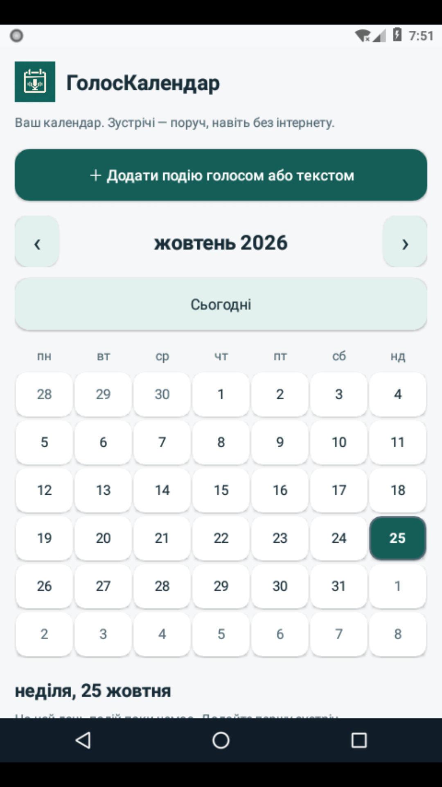

# ГолосКалендар 3.1.0 — власний календар та нова іконка

- `HolosCalendar-3.1.0-debug.apk` — інсталятор для Android 8+.
- `HolosCalendar-3.1.0-project.zip` — повний проєкт Android Studio та готовий інсталятор у папці APK.
- `SHA256SUMS.txt` — контрольні суми завантажень.

Вихідний commit: [72840cc01118c6d64e2f3db41f6ecfc36547cc6d](https://github.com/salenko93-hash/HolosCalendar-Android/tree/72840cc01118c6d64e2f3db41f6ecfc36547cc6d).

## Що додано

Нова іконка з календарем і мікрофоном у launcher та заголовках. Стартовий екран — власний місячний календар із вибором дня, позначками зустрічей і списком подій. Подію можна додати голосом або текстом, зберегти, відредагувати та видалити з підтвердженням. Повторне оновлення не створює дубль; перестворення екрана зберігає ID події та вибраний місяць.

Події зберігаються у приватній SQLite-базі на телефоні та залишаються після перезапуску застосунку. Зустрічі, що переходять через північ, відображаються в обох днях. Без названої тривалості поле показує «не вказано», вигаданий час завершення не задається.

Відкриття системного календаря залишено окремою дією; підтвердження збереження в ньому виконується в його редакторі. Синхронізація й нагадування поки не реалізовані. Очищення даних чи видалення застосунку видаляє його локальні події; хмарного резервного копіювання немає.

Перевірено: 75 JVM-тестів, 26 Android-тестів на API 26, lint без зауважень, підпис APK v2 та zipalign. Android-тести перевіряють реальну SQLite-базу, збереження/оновлення з форми, відсутність дублів і відображення події в календарі. На емуляторі також перевірено встановлення поверх 3.0.4 та запуск зі старого launcher-компонента. API 35 локально не запускався; для нього налаштовано CI. Справжнє голосове введення й зовнішній календар додатково перевіряються на телефоні.

## Установлення

Завантажте APK на телефон і відкрийте його. Підпис збігається з хмарними збірками 3.0.3 і 3.0.4: їх можна оновити цим APK. Це debug-збірка. Якщо попередню версію зібрано на іншому ПК, для збереження підпису перебудуйте проєкт на тому самому ПК.

Для роботи з кодом розпакуйте ZIP і відкрийте папку HolosCalendar в Android Studio з JDK 17.

## Вигляд календаря

